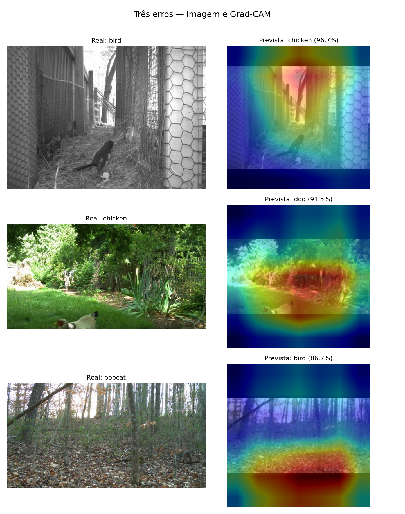
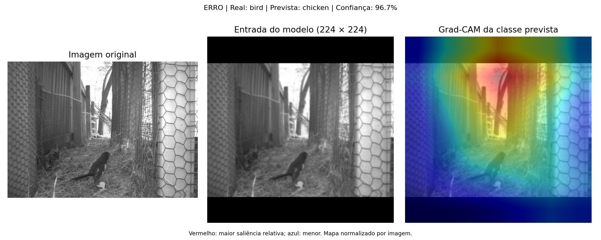
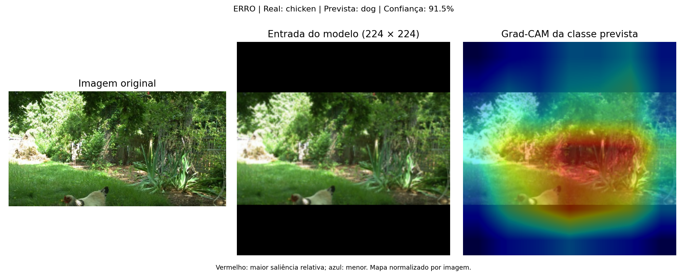
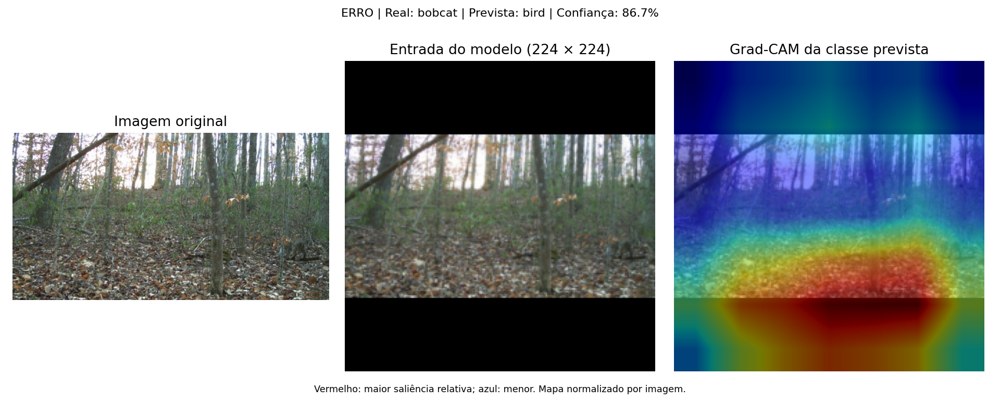
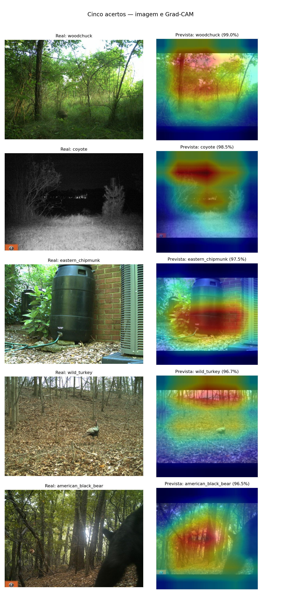
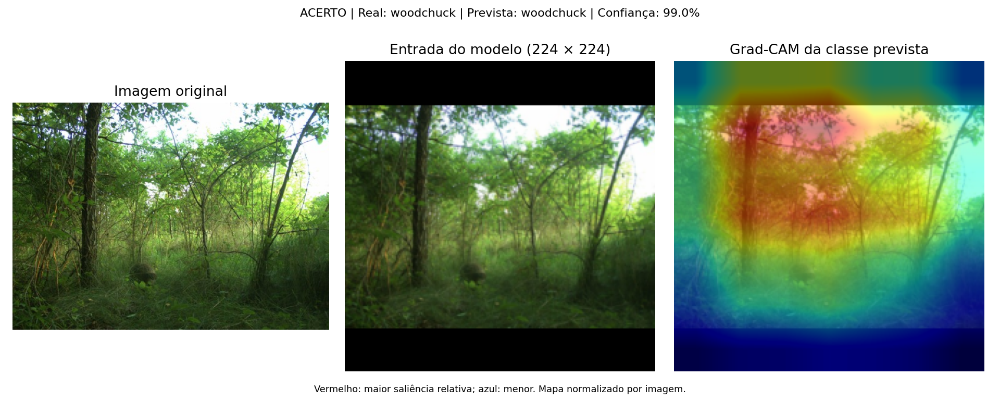
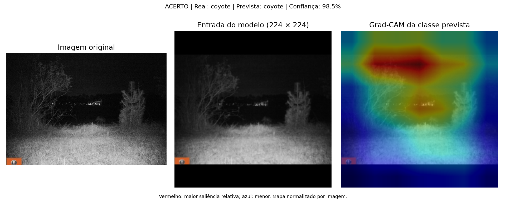
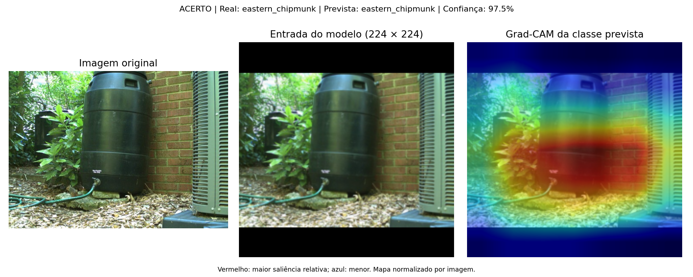
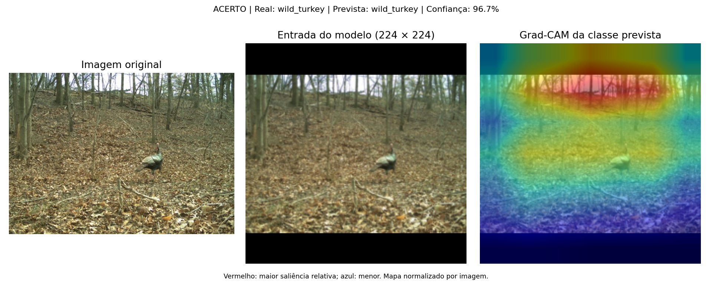
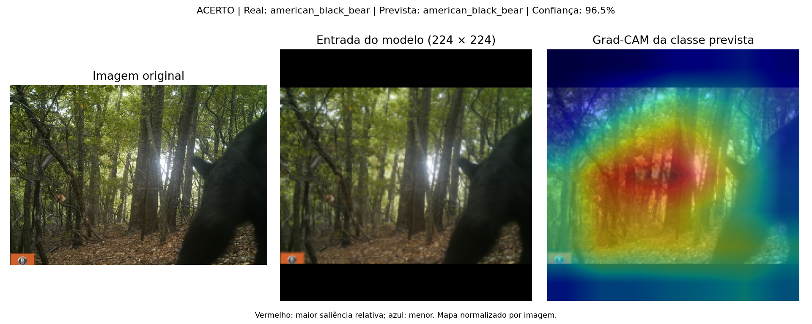

# Parte 3 — Galeria de falhas e atalhos

Modelo analisado: `parte2\resultados\simclr\rotulos_5\seed_42/best.pt`, melhor época 25.
ResNet-18, ImageNet + SimCLR com crop de 50%, fine-tuning com 5 rótulos por classe, seed 42.
Mantemos a seed 42 predefinida, sem escolher o modelo pelo resultado do teste.

Seleção: três erros e cinco acertos de maior confiança, evitando repetir a classe verdadeira dentro de cada grupo. A seleção serve ao diagnóstico qualitativo e não é uma amostra representativa do teste.

Cada painel mostra a foto original, a entrada com padding e o Grad-CAM da classe prevista. Vermelho indica maior saliência relativa; azul, menor. O mapa é calculado em layer4 (7×7) e ampliado para 224×224. O padding preto também faz parte da entrada e pode receber saliência. As cores são normalizadas separadamente por imagem.

## Três erros

### 1. Erro — ab574a4bebde65a4

Classe verdadeira: **bird**. Prevista: **chicken**. Confiança softmax: **96.69%**.

Foto em tons de cinza, com uma ave na parte inferior central de um corredor cercado por telas. A ave é visível, mas os tons mais quentes do Grad-CAM aparecem na parte superior central, sobre troncos, estruturas e a abertura ao fundo; a região do animal fica majoritariamente azul/verde. O modelo confunde bird com chicken com 96,69% de confiança. A atenção no cenário é compatível com um atalho associado ao ambiente cercado, sem demonstrar que a cerca causou a classificação.

### 2. Erro — 8312c1c37688559f

Classe verdadeira: **chicken**. Prevista: **dog**. Confiança softmax: **91.50%**.

Foto diurna de um jardim; a galinha aparece parcialmente cortada pela borda inferior. O pico quente cobre principalmente a vegetação e a região de solo à direita, acima do animal. Há saliência também no limite inferior e sobre parte da região da galinha, mas o mapa é amplo e não isola sua forma. A previsão dog com 91,50% de confiança combina erro de classe com um animal incompleto e forte saliência no contexto.

### 3. Erro — 687d28bd9fbea586

Classe verdadeira: **bobcat**. Prevista: **bird**. Confiança softmax: **86.67%**.

Foto diurna de mata, com muitos troncos e folhas secas. O rótulo do pacote é bobcat, mas não consigo delimitar o animal com segurança na foto exibida; por isso não atribuo tamanho nem posição exatos. A região vermelha fica sobre o chão de folhas na parte inferior e se estende ao padding abaixo da foto, enquanto os troncos superiores ficam frios. A previsão bird, com 86,67% de confiança, é compatível com uso de textura do cenário e/ou da borda da entrada, em vez de uma localização clara do felino.

## Cinco acertos: animal ou fundo?

### 4. Acerto — 6f0ec138fffad951

Classe verdadeira: **woodchuck**. Prevista: **woodchuck**. Confiança softmax: **98.96%**.

Acerto woodchuck em foto diurna. O animal aparece pequeno e escuro entre a vegetação na parte inferior, um pouco à esquerda do centro. Os maiores picos de saliência estão acima dele, no tronco à esquerda e na vegetação central; o animal não coincide com o pico mais quente. Mesmo com 98,96% de confiança, o mapa sugere contribuição importante do cenário, não reconhecimento inequívoco do animal.

### 5. Acerto — f68d2c8881e2fc7a

Classe verdadeira: **coyote**. Prevista: **coyote**. Confiança softmax: **98.47%**.

Acerto coyote em foto noturna em tons de cinza, com uma clareira iluminada em primeiro plano, árvores laterais e pontos luminosos ao fundo. A região avermelhada mais forte está na área escura superior, acima do horizonte, com outro foco sobre os pontos luminosos centrais. O animal tem baixo contraste e não é delimitado com segurança nesta visualização. O mapa não oferece evidência clara de foco na silhueta do coiote, apesar dos 98,47% de confiança.

### 6. Acerto — 344cd8b12b9b1bfb

Classe verdadeira: **eastern_chipmunk**. Prevista: **eastern_chipmunk**. Confiança softmax: **97.45%**.

Acerto eastern_chipmunk em foto diurna próxima a uma construção. O pequeno animal aparece junto ao chão, na região da mangueira à esquerda da base do reservatório. O pico vermelho cobre principalmente o reservatório e a parede de tijolos; o animal não está no centro desse pico. A confiança de 97,45% acompanha forte saliência em objetos do ambiente, um sinal qualitativo de possível atalho de contexto.

### 7. Acerto — ac2de5f9675331d1

Classe verdadeira: **wild_turkey**. Prevista: **wild_turkey**. Confiança softmax: **96.72%**.

Acerto wild_turkey em foto diurna. O peru está bem visível no chão de folhas, na metade inferior à direita. O mapa tem maior saliência entre os troncos e a parte superior do bosque, enquanto o animal fica em uma região verde/azulada, sem pico quente sobre seu corpo. Com 96,72% de confiança, o acerto não demonstra que a decisão se baseou principalmente na anatomia da ave.

### 8. Acerto — 4e3e6da82b10f50f

Classe verdadeira: **american_black_bear**. Prevista: **american_black_bear**. Confiança softmax: **96.49%**.

Acerto american_black_bear em foto diurna de mata. O urso ocupa uma região grande à direita e está parcialmente cortado pela borda. A área mais quente do Grad-CAM está no conjunto de troncos e vegetação ao centro/esquerda; grande parte do corpo visível permanece azul ou verde. Mesmo com um animal grande e 96,49% de confiança, a saliência destaca sobretudo o cenário. Isso é compatível com contribuição do fundo, mas não exclui informações do animal presentes nas representações internas.

## O que os exemplos mostram

Nos três erros, os picos de saliência aparecem sobretudo em elementos do cenário ou no limite inferior/padding, em vez de se concentrarem claramente no animal. Nos cinco acertos também há forte saliência em fundo e objetos do ambiente. Assim, acertar a classe não basta para afirmar que a rede reconheceu a anatomia do animal. Os casos são compatíveis com uso de atalhos de contexto, mas Grad-CAM isoladamente não prova dependência causal.

A confiança softmax não foi calibrada: 96,69% em uma previsão errada não é uma probabilidade confiável de acerto. A resolução espacial do mapa é baixa; não delimitamos os animais nem estimamos sua área como medida objetiva. Oito exemplos não permitem concluir que todos os acertos ou erros seguem esse padrão.

## Reproduzir

Na raiz do projeto: `python -u parte3/parte3.py`.

`exemplos.csv` e `exemplos.json` registram classes, confiança e arquivos. `proveniencia.json` registra checkpoint, hash e regra de seleção. Os arquivos `_gradcam.npy` guardam os mapas numéricos e `_original.png` guardam as fotos.

Os diagnósticos de inspeção visual são mantidos em `parte3_diagnosticos.json`, ao lado do script.
